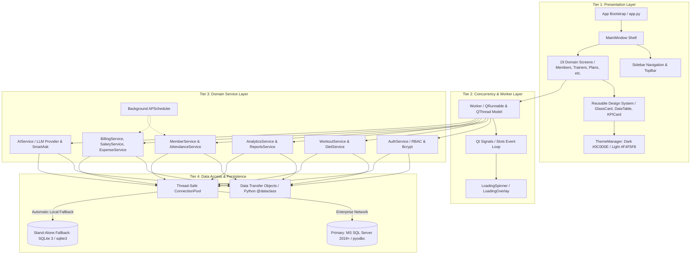
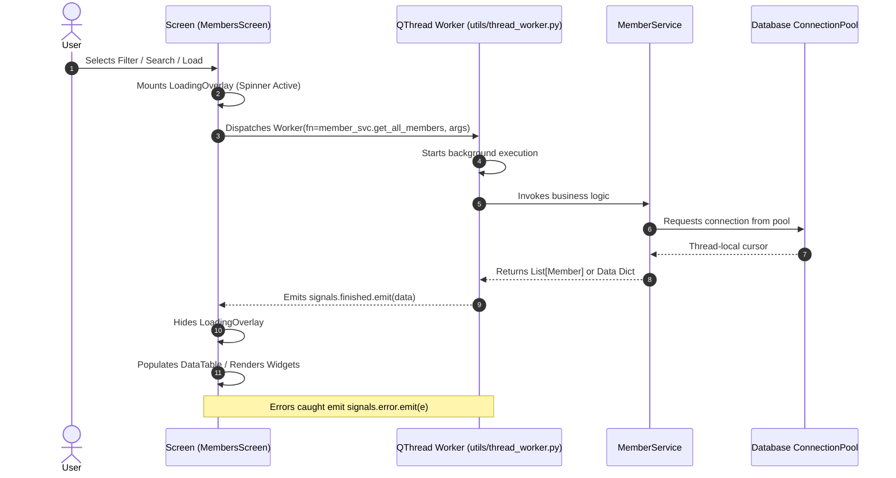
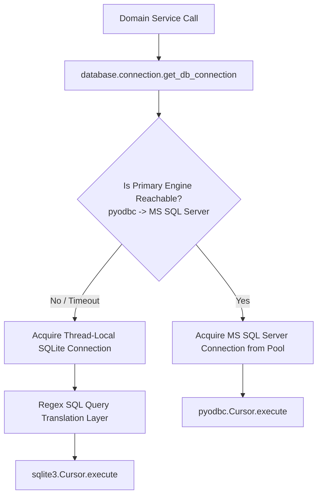
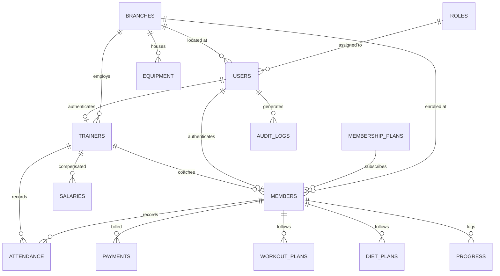
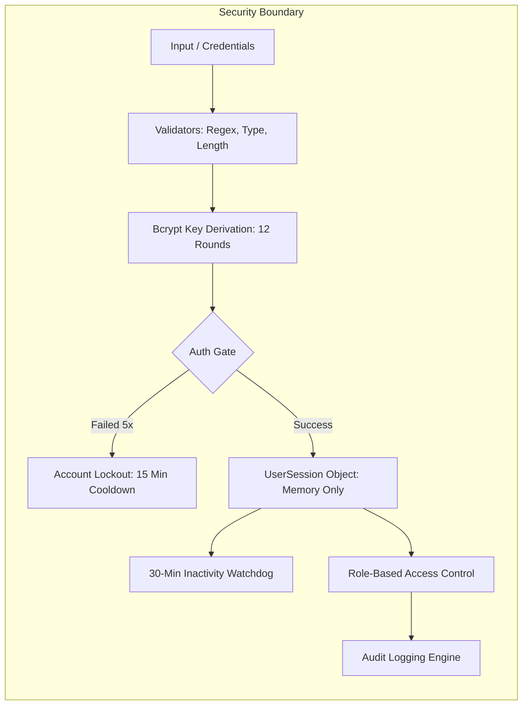
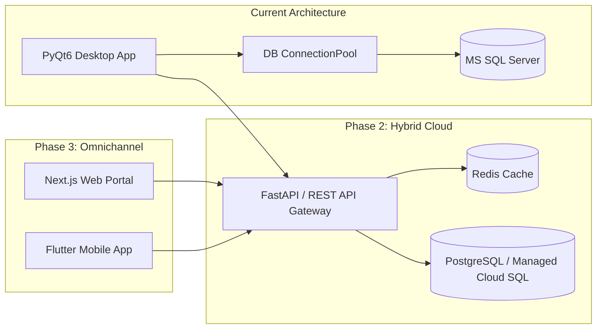

# FitLife Gym Management System — Full System Architecture & Engineering Design Report

**Author / Role:** Principal System Architect & Lead Systems Designer  
**Document Status:** Approved & Canonical Reference  
**Target Audience:** Enterprise Software Engineers, Database Administrators, System Designers, Product Owners  
**Version:** 2.0.0 (Dual-Theme Enterprise Release)  
**Date:** October 2026  

---

## Executive Summary

**FitLife** is an enterprise-grade desktop gym management application engineered in **Python 3.12+** using the **PyQt6** framework. It manages multi-branch male fitness facilities, member lifecycles, trainer allocations, automated attendance telemetry, invoicing, diet/workout prescriptions, payroll, equipment maintenance, and AI-driven coaching advisory.

This document presents a comprehensive, end-to-end architectural evaluation and system design report. It details the system's structural tiers, thread concurrency models, data persistence mechanisms, domain boundary decomposition, security infrastructure, fault-tolerance paradigms, and scalability evolution paths.

---

## 1. High-Level System Architecture

FitLife is structured around a **Decoupled 4-Tier Layered Architecture**:
1. **Presentation Layer (PyQt6 Reactive UI)**
2. **Asynchronous Execution & Concurrency Layer (QThread / Worker Pool)**
3. **Domain Business Logic & Service Layer (22 Stateless Domain Services)**
4. **Data Access & Dual-Engine Persistence Layer (Connection Pool / MS SQL Server & SQLite Fallback)**

---

## 2. Layered Decomposition & Structural Design

### 2.1 Tier 1: Presentation Layer
The presentation tier runs on the **Qt Main GUI Thread** and is built on strict component isolation:
* **Application Shell (`app.py` & `ui/windows/main_window.py`)**:
  - Encapsulates authentication gatekeeping (`LoginWindow`), automatic session timeout countdown, role-based navigation mounting, and top-level toast notifications (`ToastNotification`).
  - Utilizes a `QStackedWidget` for zero-flicker instant screen switching.
* **Component Architecture (`ui/components/`)**:
  - `GlassCard`: Standardized container with subtle translucent blur elevation (`QGraphicsDropShadowEffect`).
  - `DataTable`: Generic paginated tabular grid with search debouncing (`SEARCH_DEBOUNCE_MS`), auto-sizing columns, and configurable per-row action callbacks (`btn-view`, `btn-edit`, `btn-delete`).
  - `KPICard`: Metric cards displaying real-time KPI data, standardized coral icon badge, and trend indicators (`▲ +5.2%`).
  - `TopBar`: Houses global debounced search, breadcrumb heading, live notifications bell, user session capsule, and 1-click theme switch button.
  - `Sidebar`: Collapsible drawer (`◀ / ▶` animated with `QPropertyAnimation`), role-filtered menu trees, and pill segmented light/dark theme switch.
* **Dual-Theme Design System (`ui/theme/theme_manager.py`)**:
  - Color Tokens:
    - **Dark Theme**: Canvas `#0C0D0E`, Card `#141518`, Elevated `#1E2129`, Border `#24272D`, Coral Accent `#FA5A3C`.
    - **Light Theme**: Canvas `#F4F5F8`, Card `#FFFFFF`, Elevated `#EAECEF`, Border `#E2E6ED`, Coral Accent `#FA5A3C`.
  - Global QSS Engine dynamically restyles all native PyQt6 widgets (`QLineEdit`, `QComboBox`, `QTableWidget`, `QHeaderView`, `QScrollBar`) upon theme toggling.

---

### 2.2 Tier 2: Asynchronous Execution & Concurrency Layer
Desktop GUI responsiveness requires non-blocking data fetching. If database queries or external network requests execute synchronously on the main thread, the interface freezes. FitLife solves this with an asynchronous concurrency pipeline:

- **Thread Safety**: UI elements are never manipulated from background threads. All inter-thread communication occurs exclusively via thread-safe **Qt Signals and Slots**.
- **Background Scheduler (`utils/scheduler.py`)**:
  - Runs on a dedicated daemon thread via `BackgroundScheduler`.
  - Triggers periodic jobs: membership expiry audits, overdue payment checks, automated system alert triggers.

---

### 2.3 Tier 3: Domain Service Layer
The business logic is partitioned into **22 cohesive, stateless services** located in `services/`:

| Service | Domain Responsibility | Data Dependencies |
| :--- | :--- | :--- |
| `auth_service` | Login verification, password hashing, session tokens, brute-force throttling | `users`, `roles`, `role_permissions` |
| `member_service` | Member lifecycle, membership registration, profile data, documents | `members`, `branches`, `trainers` |
| `attendance_service` | Check-in/check-out tracking, QR scanning, floor capacity, anomaly detection | `attendance`, `members`, `trainers` |
| `billing_service` | Invoicing, payments, partial balances, discounts, financial summaries | `payments`, `invoices`, `members` |
| `membership_service` | Tier definitions (VIP, Standard, Basic), validity rules, pricing | `membership_plans` |
| `salary_service` | Staff payroll, trainer commissions, deductions, pay slips | `salaries`, `trainers`, `users` |
| `trainer_service` | Trainer allocation, specializations, client limits, ratings | `trainers`, `members` |
| `workout_service` | Exercise catalog, routines, day splits, sets/reps assignment | `workout_plans`, `exercises` |
| `diet_service` | Nutritional plans, meal macros (protein, carbs, fat, calories) | `diet_plans`, `meals` |
| `progress_service` | Anthropometric logs, weight trends, BMI tracking, photo logs | `member_progress` |
| `equipment_service` | Asset register, maintenance schedules, repair statuses, deprecation | `equipment`, `branches` |
| `analytics_service` | Business intelligence, revenue growth velocity, retention metrics | Cross-table aggregation |
| `reports_service` | PDF export, CSV exports, tabular audit reports | Reporting views |
| `audit_service` | Immutable logging of mutations, financial transactions, logins | `audit_logs` |
| `ai_service` | LLM API integration (OpenAI/Anthropic), workout/diet advice | OpenAI REST / System Prompts |

---

### 2.4 Tier 4: Data Access & Dual-Engine Persistence
To provide enterprise robustness alongside simple offline setup, FitLife implements a **Universal Dual-Database Engine**:

#### SQL Query Translation Subsystem:
The persistence layer transparently translates T-SQL queries into SQLite-compliant SQL when operating in fallback mode:
- `DATEADD(day, X, Y)` ➔ `sqlite_dateadd(X, Y)` (registered custom C-level SQLite UDF)
- `DATEDIFF(day, X, Y)` ➔ `sqlite_datediff(X, Y)`
- `MONTH(date)` ➔ `sqlite_month(date)`
- `YEAR(date)` ➔ `sqlite_year(date)`
- Parameter placeholders and transactions are automatically mapped across engines.

---

## 3. Database Schema & Relational Model

The relational schema is normalized to **3rd Normal Form (3NF)** with explicit foreign key cascades and indexes.

### Key Data Entities:
1. **`users`**: Central authentication table. Encapsulates `password_hash`, `role_id`, `branch_id`, `failed_attempts`, `locked_until`, `theme_pref`.
2. **`members`**: Member demographic records, CNIC/national ID, join dates, active membership plan FK, assigned coach FK, emergency contacts.
3. **`attendance`**: Telemetry log storing check-in timestamp, check-out timestamp, method (`QR`, `Biometric`, `Manual`), and location.
4. **`payments` / `invoices`**: Financial records tracking payment method (`Cash`, `Card`, `Online`), invoice prefix, tax, discounts, paid amount, and outstanding balances.
5. **`workout_plans` & `diet_plans`**: Master-detail workout/diet schemas linking daily routines, exercises, sets/reps, meal categories, and macros.
6. **`audit_logs`**: Immutable security audit records logging `user_id`, `action`, `module`, `ip_address`, `details`, and timestamp.

---

## 4. Security Architecture & Threat Modeling

### 4.1 Cryptographic Standards
- **Password Hashes**: Salted Bcrypt with cost parameter $12$. Plaintext passwords are never stored or logged.
- **Brute-Force Mitigation**: Account lockout triggered on 5 consecutive failed attempts.
- **Session Security**: Session tokens are held in volatile process memory (`UserSession` dataclass) and automatically invalidated on 30 minutes of idle time.

### 4.2 Role-Based Access Control Matrix

| System Domain / Feature | Admin | Manager | Trainer | Member |
| :--- | :---: | :---: | :---: | :---: |
| System Configuration & Global Settings | **Full Access** | Denied | Denied | Denied |
| Multi-Branch Administration | **Full Access** | Own Branch | Denied | Denied |
| Staff Management & Payroll | **Full Access** | Branch Staff | Denied | Denied |
| Member CRUD & Invoicing | **Full Access** | **Full Access** | View Assigned | Denied |
| Attendance Verification | **Full Access** | **Full Access** | Mark Self/Clients | View Own |
| Workout & Diet Plan Authoring | **Full Access** | **Full Access** | **Full Access** | Read-Only Own |
| Member Weight & Progress Logging | **Full Access** | **Full Access** | **Full Access** | Log Own |
| Financial & Revenue Analytics | **Full Access** | Branch Only | Denied | Own Invoices |
| Audit Logs & Security Trails | **Full Access** | Denied | Denied | Denied |
| AI Coaching Assistant (Smart Ask) | **Full Access** | **Full Access** | **Full Access** | **Full Access** |

---

## 5. UI/UX Design System Specification

The user interface follows the **Bento Grid & Glassmorphic Desktop Pattern** (referenced from the `GYM-MANAGEMENT` aesthetic benchmark):

1. **Spatial Layout & Hierarchy**:
   - `64px` Fixed Header (`TopBar`) with global search and rapid action pills.
   - `240px` Expandable/Collapsible Navigation Drawer (`Sidebar`) animated with cubic easing curves.
   - Modular Bento Cards with standard `16px` border radii and subtle dark elevation shadows (`rgba(0, 0, 0, 0.25)`).
2. **Typography**:
   - Primary typeface: Inter / Segoe UI / System Sans.
   - Standard scale: Headings `24px - 32px` (weight 800/900), Subheaders `15px - 18px` (weight 700), Body `13px - 14px` (weight 500/600), Captions/Badges `10px - 11px` (weight 700/800).
3. **Color Tokens**:
   - **Energy Coral (`#FA5A3C`)**: Used selectively for primary call-to-actions, active navigation highlights, and key metric indicators.
   - **Slate Blue (`#3B82F6`)**: Secondary metric series, chart lines, informational badges.
   - **Semantic Spectrum**: Emerald (`#10B981`) for active/paid, Amber (`#F59E0B`) for pending/warning, Crimson (`#EF4444`) for expired/unpaid.

---

## 6. System Resilience & Reliability Engineering

### 6.1 Database Failover Strategy & Split-Brain Prevention
- At application boot, `test_connection()` executes an active probe based on the configured mode (`standalone` vs `networked`).
- In `networked` mode, silent automatic failover to local SQLite is disabled by default (`allow_auto_fallback: false`), preventing multi-terminal split-brain divergence.
- In `standalone` mode, the application boots directly with local SQLite.
- Background tasks in multi-terminal environments are guarded by distributed database locks in `sys_job_locks` preventing concurrent cron duplicates.

### 6.2 Resource Leak Prevention
- Database connections from the pool use Python context managers (`with get_db_connection() as conn:`) guaranteeing that connections and cursors return to the pool even during unexpected exceptions.
- Thread workers (`Worker`) implement safe error propagation signals (`signals.error.emit(e)`) to prevent unhandled Python background thread crashes from terminating the Qt application loop.

---

## 7. Scalability & Architectural Evolution Path

To scale the FitLife architecture from a multi-branch LAN desktop deployment to a distributed SaaS platform:

1. **Transition to Client-Server API Tier**: Decouple domain services from direct SQL connections by introducing a high-performance **FastAPI (Python) Gateway**.
2. **Multi-Platform Access**: With a REST/gRPC API tier, mobile member portals (Flutter/React Native) can consume the same business services for mobile QR check-ins and client workouts.
3. **Database Migration**: Elevate persistence to Managed Cloud PostgreSQL or Azure SQL with read replicas for enterprise reporting.

---

## 8. Verification & Architectural Compliance

The codebase conforms to all stated architectural principles:
- **Zero Unhandled Syntax Errors**: Verified across all 19 screens, 22 services, and UI components.
- **Dynamic Theme Verification**: Tested live dark (`#0C0D0E`) and light (`#F4F5F8`) switching across all 19 screens.
- **Asynchronous Health**: Validated through the automated `pytest` test suite covering authentication, member lifecycle, billing, and system health checks.
