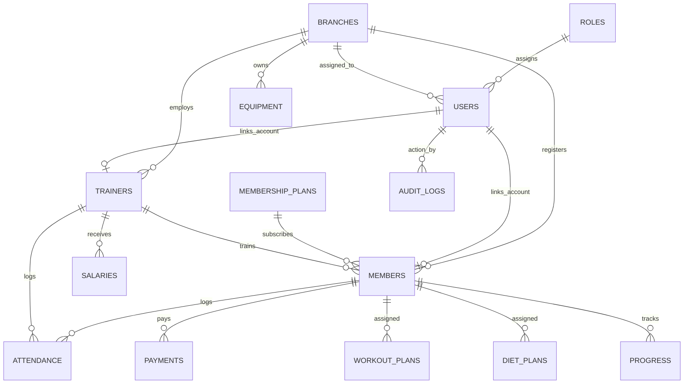

# FitLife Database Schema Reference

This document provides a detailed specification of the database architecture, table definitions, relationships, constraints, and dual-engine details for **FitLife Gym Management System**.

---

## 1. Database Architecture Overview

FitLife supports dual database engines:
1. **MS SQL Server 2019+ (`schema.sql`)**: Enterprise database engine featuring stored identity columns, `DATETIME2` high precision timestamps, table constraints, and foreign key cascades.
2. **SQLite 3 (`schema_sqlite.sql`)**: Embedded SQL database engine using `INTEGER PRIMARY KEY AUTOINCREMENT`, text/real storage types, and equivalent relational constraints.

---

## 2. Entity-Relationship (ER) Model Overview

---

## 3. Core Database Tables & Data Dictionary

### 3.1 Authentication & RBAC Core

#### `roles`
Stores standard user roles in the system.
- `id` (INT, PK, Auto)
- `role_name` (NVARCHAR(50), Unique) — Values: `Admin`, `Manager`, `Trainer`, `Member`
- `description` (NVARCHAR(255))

#### `users`
System user accounts for authentication and session management.
- `id` (INT, PK, Auto)
- `username` (NVARCHAR(100), Unique)
- `password_hash` (NVARCHAR(255)) — Bcrypt hash string
- `role_id` (INT, FK → `roles.id`)
- `full_name` (NVARCHAR(150))
- `email`, `phone` (NVARCHAR)
- `branch_id` (INT, FK → `branches.id`, Nullable)
- `is_active` (BIT / INT) — Default: `1`
- `failed_attempts` (INT) — Counter for lockout threshold (5 attempts)
- `locked_until` (DATETIME2 / TEXT) — Lockout expiry timestamp
- `theme_pref` (NVARCHAR(10)) — `dark` / `light`

#### `role_permissions`
Fine-grained module access rules per role.
- `id` (INT, PK)
- `role_id` (INT, FK → `roles.id`)
- `module_name` (NVARCHAR(60)) — e.g. `Members`, `Billing`, `Analytics`
- `can_view`, `can_create`, `can_edit`, `can_delete` (BIT / INT)

---

### 3.2 Facilities & Personnel

#### `branches`
Gym branch physical locations.
- `id` (INT, PK)
- `branch_name` (NVARCHAR(100))
- `city`, `address`, `phone`, `email`
- `capacity` (INT) — Default: `100`
- `opening_date` (DATE)
- `status` (NVARCHAR(30)) — `Active`, `Closed`, `Under Renovation`
- `manager_id` (INT, FK → `users.id`)

#### `trainers`
Fitness instructor records.
- `id` (INT, PK)
- `user_id` (INT, FK → `users.id`, Nullable)
- `branch_id` (INT, FK → `branches.id`)
- `full_name` (NVARCHAR(150))
- `cnic` (NVARCHAR(13), Unique, 13 digits)
- `phone`, `email`, `address`, `photo_path`
- `specialization` (NVARCHAR(60))
- `monthly_salary` (DECIMAL(10,2))
- `hire_date` (DATE)
- `status` (NVARCHAR(20)) — `Active`, `Inactive`, `On Leave`

#### `members`
Gym member profiles & membership state.
- `id` (INT, PK)
- `user_id` (INT, FK → `users.id`, Nullable)
- `branch_id` (INT, FK → `branches.id`)
- `plan_id` (INT, FK → `membership_plans.id`)
- `trainer_id` (INT, FK → `trainers.id`, Nullable)
- `full_name` (NVARCHAR(150))
- `cnic` (NVARCHAR(13), Unique)
- `phone`, `email`, `address`, `emergency_contact`, `photo_path`
- `join_date` (DATE), `expiry_date` (DATE)
- `status` (NVARCHAR(20)) — `Active`, `Expired`, `Frozen`, `Cancelled`

---

### 3.3 Financial & Operations

#### `membership_plans`
Subscription pricing packages.
- `id` (INT, PK)
- `plan_name` (NVARCHAR(100))
- `duration_days` (INT) — e.g. 30, 90, 365
- `price` (DECIMAL(10,2))
- `is_active` (BIT / INT)

#### `payments`
Member billing transactions & receipts.
- `id` (INT, PK)
- `member_id` (INT, FK → `members.id`)
- `amount` (DECIMAL(10,2))
- `payment_date` (DATETIME2)
- `payment_method` (NVARCHAR(40)) — `Cash`, `Card`, `Bank Transfer`, `Online`
- `invoice_no` (NVARCHAR(50), Unique)
- `status` (NVARCHAR(20)) — `Paid`, `Pending`, `Refunded`

#### `salaries`
Staff & trainer payroll disbursements.
- `id` (INT, PK)
- `trainer_id` (INT, FK → `trainers.id`, Nullable)
- `user_id` (INT, FK → `users.id`, Nullable)
- `month_year` (NVARCHAR(7)) — Format `YYYY-MM`
- `basic_salary`, `bonus`, `deductions`, `net_salary` (DECIMAL(10,2))
- `payment_date` (DATE), `status` (NVARCHAR) — `Paid`, `Pending`

#### `attendance`
Biometric & manual check-in tracking.
- `id` (INT, PK)
- `member_id` (INT, FK → `members.id`, Nullable)
- `trainer_id` (INT, FK → `trainers.id`, Nullable)
- `check_in` (DATETIME2), `check_out` (DATETIME2)
- `date` (DATE), `status` (NVARCHAR(20)) — `Present`, `Late`, `Absent`

---

### 3.4 Fitness, Health & Equipment

#### `workout_plans` & `exercise_library`
Custom workout routines and catalog of exercises.
- `workout_plans`: `id`, `member_id`, `trainer_id`, `plan_name`, `goal`, `start_date`, `end_date`, `status`
- `exercise_library`: `id`, `exercise_name`, `category`, `muscle_group`, `equipment_needed`

#### `diet_plans`
Nutrition & meal schedules.
- `id`, `member_id`, `trainer_id`, `plan_name`, `daily_calories`, `protein_g`, `carbs_g`, `fats_g`, `diet_type`

#### `progress_tracking`
Body metrics progression over time.
- `id`, `member_id`, `recorded_date`, `weight_kg`, `height_cm`, `bmi`, `body_fat_pct`, `chest_cm`, `waist_cm`, `biceps_cm`

#### `equipment`
Branch assets & maintenance tracking.
- `id`, `branch_id`, `equipment_name`, `category`, `serial_number`, `purchase_date`, `cost`, `status` (`Operational`, `Needs Repair`, `Under Maintenance`)

---

### 3.5 System & Security Tracking

#### `audit_logs`
System security and action trail.
- `id` (INT, PK)
- `user_id` (INT, FK → `users.id`)
- `action` (NVARCHAR(100)) — e.g. `LOGIN_SUCCESS`, `MEMBER_CREATED`, `PAYMENT_RECORDED`
- `details` (NVARCHAR(MAX) / TEXT)
- `ip_address` (NVARCHAR(45))
- `created_at` (DATETIME2)

#### `notifications`
System alerts and user notifications.
- `id`, `user_id`, `title`, `message`, `is_read`, `created_at`
