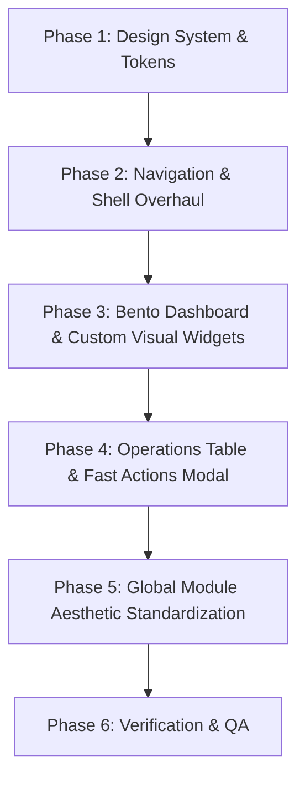

# FitLife UI/UX Modernization & Design Implementation Plan
**Source Reference**: `GYM-MANAGEMENT` (Next.js / Tailwind CSS / Lucide)  
**Target Application**: `FitLife Gym Management App` (PyQt6 / Python)  
**Date**: October 2026  

---

## 1. Executive Summary & Design Vision

The objective is to completely translate the high-tier, editorial dashboard UI/UX and design system from the web application in `GYM-MANAGEMENT` to the native desktop **FitLife PyQt6** system.

### Core Visual Principles from `GYM-MANAGEMENT`:
1. **Curated Color Tokens**:
   - **Primary Canvas**: Dark `#0C0D0E` / Light `#F4F5F8`
   - **Card & Container Surfaces**: Dark `#141518` & `#181A1F` / Light `#FFFFFF`
   - **Borders & Dividers**: Dark `#24272D` & `#2B2F38` / Light `#E2E6ED` & `#E6E9EE`
   - **Signature Accent 1 (Energy Coral)**: `#FA5A3C` (Hover: `#E54829`, Subtle Background: `#FFF2F0` / `#2A1715`)
   - **Signature Accent 2 (Performance Blue)**: `#3B82F6` (Hover: `#2563EB`, Subtle Background: `#EFF6FF` / `#15233D`)
   - **Status Indicators**: Success `#10B981`, Warning `#F59E0B`, Critical `#EF4444`
   - **Typography Palette**: Primary `#18181B` (Light) / `#FFFFFF` (Dark), Secondary `#6B7280` / `#9CA3AF`, Muted `#8C93A3`

2. **UX & Interaction Hallmarks**:
   - **3-Zone Bento Grid Dashboard**: Multi-column responsive layout with clear hierarchy.
   - **Horizontal KPI Metric Strip**: High-density inline metrics separated by vertical hairline dividers with directional change chips (`+5.2%`, `+15%`).
   - **Interactive Multi-Series Curved Charts**: Smooth dual-curve bezier paths (Check-ins vs Revenue) with interactive timeframe pills (`7D`, `30D`, `90D`, `YTD`), series legend checkboxes, and hover tooltips.
   - **Analog Floor Traffic Meter**: Real-time semi-circular needle gauge with 16-hour crowd density forecast bar chart.
   - **Multi-Tab Data Table with In-Row Expandable Drawer**: Instant tab filtering (`Live Floor`, `All Members`, `Renewals Due`, `Equipment Health`, `Turnstiles`) + expandable accordion rows with circular fitness score rings and quick clock-in toggles.
   - **Tree-Structured Collapsible Navigation**: Circular brand emblem, grouped tree hierarchy with connector guides, and a sleek bottom pill theme switcher.

---

## 2. Gap Analysis (Current PyQt6 vs. Reference)

| Component / Feature | Current FitLife Desktop Implementation | Reference `GYM-MANAGEMENT` Implementation | Target Plan |
| :--- | :--- | :--- | :--- |
| **Color System & QSS** | Dark `#0B0F19` with electric cyan/blue `#00F5FF` accents | Minimalist editorial dark `#0C0D0E` with energy coral `#FA5A3C` and slate `#3B82F6` | Migrate `theme_manager.py` to match exact reference palette |
| **Icons Engine** | Basic set of 25 icons | Extensive Lucide vector suite (`Globe`, `Radio`, `Flame`, `Activity`, `Sparkles`, `UserCheck`, `Wifi`, etc.) | Expand `ui/components/icons.py` with missing SVG vectors |
| **Sidebar Navigation** | Standard flat list of buttons | Circular brand globe button, grouped tree navigation with visual connector lines, and bottom pill theme toggle | Refactor `ui/components/sidebar.py` into tree navigation matching `Sidebar.tsx` |
| **TopBar** | Basic search box and separate buttons | Pill search input, live alert notification badge counters, quick role switcher, and profile popover | Enhance `ui/components/topbar.py` with alert badges and sleek styling |
| **Dashboard** | `DashboardPlaceholder` with basic cards | Full Bento layout: KPI strip + Bezier graph + Gym Floor Traffic gauge + Expandable Drawer Table | Create new comprehensive `BentoDashboard` screen |
| **Floor Traffic Telemetry** | Not present | Gauge meter dial + 16-hour crowd forecast bars | Implement custom PyQt6 painter gauge and bar chart |
| **Interactive Table** | Standard QTableWidget without nesting | Multi-tab segmented filter + expandable in-row detail cards with SVG fitness score ring | Build custom nested drawer table component |
| **Fast Actions** | Deep navigation into forms | Fast check-in modal dialog with instantaneous search | Implement `FastCheckInDialog` popup |

---

## 3. Step-by-Step Implementation Roadmap

### Phase 1: Design Tokens & SVG Vector Engine
- [ ] **Task 1.1: Harmonize Color Tokens in `ui/theme/theme_manager.py`**
  - Add dark tokens: canvas `#0C0D0E`, card `#141518`, elevated `#181A1F`, border `#24272D`, sub-border `#2B2F38`.
  - Add light tokens: canvas `#F4F5F8`, card `#FFFFFF`, border `#E2E6ED`, sub-border `#E6E9EE`.
  - Add accent tokens: coral `#FA5A3C`, coral hover `#E54829`, coral tint `#FFF2F0` (light) / `#2A1715` (dark).
  - Add blue accent tokens: `#3B82F6`, hover `#2563EB`, tint `#EFF6FF` (light) / `#15233D` (dark).
- [ ] **Task 1.2: Enrich `ui/components/icons.py`**
  - Incorporate SVG strings for: `globe`, `radio`, `flame`, `activity`, `sparkles`, `user-check`, `wifi`, `shield-check`, `wrench`, `arrow-up-right`, `chevron-down`, `dumbbell`.

### Phase 2: Shell & Navigation Overhaul (`Sidebar` & `TopBar`)
- [ ] **Task 2.1: Re-engineer `ui/components/sidebar.py`**
  - **Header**: Circular floating emblem button (Globe icon) with rounded hover borders.
  - **Navigation Grouping**:
    - Direct items: `Dashboard`, `Members`, `Workout Programs`, `Diet & Nutrition`, `Billing`, `Revenue Analytics`, `Settings`.
    - Collapsible section: **Gym Operations** with expandable sub-items (`Branch Facilities`, `Staff & Trainers`, `Equipment & Repairs`) featuring subtle tree connector lines.
  - **Item Styling**: Pill-shaped containers (`rounded-xl`), mini-badge active indicators with contrasting icon colors.
  - **Footer**: Compact horizontal pill theme switcher (`[Sun | Moon]`) and subtle brand mark.
- [ ] **Task 2.2: Modernize `ui/components/topbar.py`**
  - Pill search box with subtle border and focus transition.
  - Real-time notification bell with counter badges for expiring memberships and maintenance tickets.
  - Role switcher dropdown chip and clean user info badge.

### Phase 3: Bento Dashboard & Custom Visual Widgets
- [ ] **Task 3.1: KPI Metrics Strip Widget**
  - Horizontal high-density card showing 6 key indicators:
    1. *Active Members* (e.g., `1,284` with `+5.2%` green chip)
    2. *Live Floor* (Active check-ins count with `+15%` chip)
    3. *Gross Revenue* (Total revenue formatted with `+9.4%` chip)
    4. *Renewal Rate* (`94.2%` with `+3.1%` chip)
    5. *Staff On Duty* (`8 Active Coaches`)
    6. *Equipment Health* (`98% Operational`)
  - Clean vertical hairline separators between items.
- [ ] **Task 3.2: Multi-Series Interactive Performance Trend Graph**
  - Custom `QWidget` using `QPainter` with anti-aliasing:
    - Smooth cubic bezier curves for **Check-ins** (Coral `#FA5A3C` with vertical gradient fill) and **Gross Revenue** (Blue `#3B82F6`).
    - Segmented timeframe pills: `7D`, `30D`, `90D`, `YTD`.
    - Interactive series checkboxes to toggle lines on/off.
    - Hover tracking showing date label, check-ins, revenue, and percentage changes in a floating tooltip pill.
- [ ] **Task 3.3: Live Gym Floor Traffic Widget (`GymFloorTraffic`)**
  - **Occupancy Dial**: Custom 180° semi-circular analog gauge with needle sweep matching live occupancy percentage.
  - **Status Pill**: Dynamic status indicator (`Low Traffic · Open Floor`, `Moderate Traffic · Steady Flow`, `Peak Traffic · Busy Period`).
  - **Hourly Crowd Forecast**: 16-hour bar chart (6 AM to 10 PM) displaying occupancy levels with current hour highlighted.

### Phase 4: Operations Table & Fast Action Modals
- [ ] **Task 4.1: Segmented Operations Table Widget**
  - Multi-tab pill switcher: `Live Floor`, `All Members`, `Renewals Due`, `Equipment Health`, `Turnstiles & Gates`.
  - Action button: `+ Fast Check-In`.
  - Column schema matching modern layout: Member/Equipment, Contact, Plan, Quality Badge, Branch, and Action.
- [ ] **Task 4.2: Expandable In-Row Accordion Drawer**
  - Clicking a row smoothly toggles an expanded sub-panel containing:
    - 4 stat cards: Account Status, Membership Plan, Weekly Visits, and Fitness Adherence Ring Gauge (circular SVG arc).
    - 1-click Clock-In / Clock-Out toggle button.
    - Direct renew plan button for expiring accounts.
- [ ] **Task 4.3: Fast Athlete Check-In Dialog**
  - Modern modal overlay dialog with search input, instant member filtering, and 1-click floor clock-in/out.

### Phase 5: Module-by-Module UI/UX Standardization
- [ ] **Task 5.1: Members & Attendance Screens**
  - Harmonize card borders, badges, table styling, and search inputs with the new design language.
- [ ] **Task 5.2: Billing & Finance Modules**
  - Adapt the clean invoice modal and ledger layouts inspired by `BillingModule.tsx` and `InvoiceModal.tsx`.
- [ ] **Task 5.3: Workout & Diet Modules**
  - Modernize program cards, exercise sets, and macronutrient progress bars following `WorkoutModule.tsx` and `DietModule.tsx`.
- [ ] **Task 5.4: Equipment & Facility Screens**
  - Style equipment status indicators (`Operational`, `Maintenance`, `Out of Order`) and repair logs following `EquipmentModule.tsx`.

### Phase 6: Testing & Verification
- [ ] **Task 6.1: Visual QA & Theme Switching**
  - Verify seamless transitions between Dark (`#0C0D0E`) and Light (`#F4F5F8`) modes across all screens without contrast or font clipping issues.
- [ ] **Task 6.2: Responsiveness & High-DPI Scaling**
  - Test on standard (1080p) and scaled displays to ensure layouts adapt gracefully.
- [ ] **Task 6.3: Non-blocking Background Performance**
  - Ensure all database queries and metric computations execute asynchronously via `QThread` without freezing UI interactions.

---

## 4. Proposed File Changes & Deliverables

| Target File | Scope of Work |
| :--- | :--- |
| `ui/theme/theme_manager.py` | Complete palette update (Coral `#FA5A3C`, Slate Blue `#3B82F6`, Dark `#0C0D0E`, Light `#F4F5F8`, cards, borders, QSS) |
| `ui/components/icons.py` | Addition of 15+ Lucide SVG icons matching the reference system |
| `ui/components/sidebar.py` | Tree navigation rewrite with brand emblem, operations submenu, and pill theme toggle |
| `ui/components/topbar.py` | Modern pill search, alert counter chips, and profile header styling |
| `ui/screens/dashboard/bento_dashboard.py` | Brand-new dashboard replacing placeholder with full Bento layout |
| `ui/screens/dashboard/performance_chart.py` | Custom QPainter multi-series smooth bezier curve chart |
| `ui/screens/dashboard/floor_traffic_widget.py` | Analog needle gauge and 16-hour crowd forecast chart |
| `ui/screens/dashboard/operations_table.py` | Segmented table with expandable accordion row drawers |
| `ui/windows/main_window.py` | Wiring new Bento dashboard, updated navigation keys, and shell layout |
| `docs/ui-ux-design-system.md` | Complete design system documentation and component specs |
